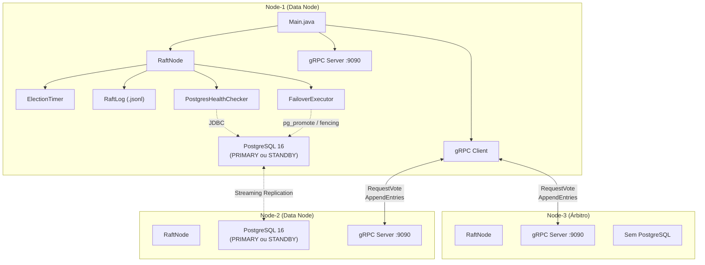
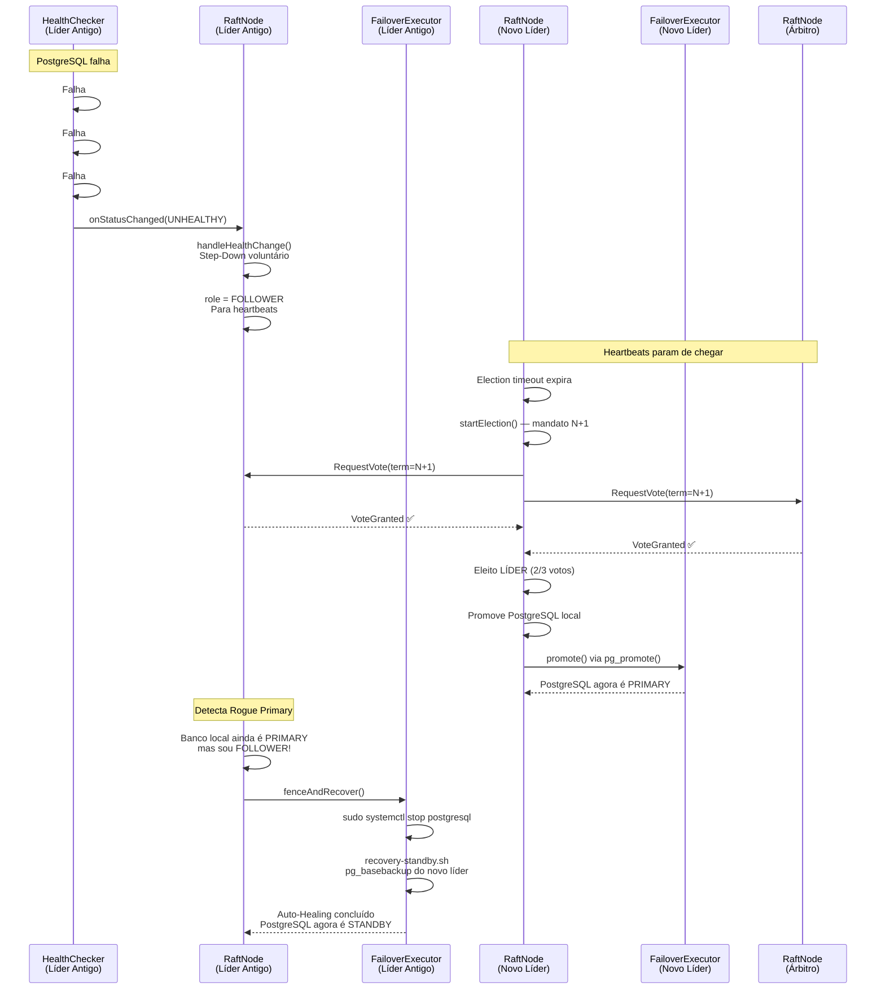

# Análise Completa da Codebase — raft-ha-manager

> Análise técnica detalhada de todos os artefatos do projeto: código Java, scripts Shell, protobuf, configurações e decisões arquiteturais.

---

## 1. Inventário Completo do Projeto

### 1.1 Código Java (18 arquivos fonte)

| Pacote | Arquivo | Linhas | Propósito |
|--------|---------|--------|-----------|
| `com.tcc.raft` | [Main.java](file:///C:/Users/guimi/.gemini/antigravity/worktrees/tcc/monografia-postgresql-scada-raft/raft-ha-manager/src/main/java/com/tcc/raft/Main.java) | 138 | Ponto de entrada. Carrega YAML, inicializa componentes e registra shutdown hook |
| `com.tcc.raft.core` | [RaftNode.java](file:///C:/Users/guimi/.gemini/antigravity/worktrees/tcc/monografia-postgresql-scada-raft/raft-ha-manager/src/main/java/com/tcc/raft/core/RaftNode.java) | 940 | Máquina de estados principal do Raft (FOLLOWER/CANDIDATE/LEADER) |
| `com.tcc.raft.core` | [RaftLog.java](file:///C:/Users/guimi/.gemini/antigravity/worktrees/tcc/monografia-postgresql-scada-raft/raft-ha-manager/src/main/java/com/tcc/raft/core/RaftLog.java) | 289 | Log persistente em formato JSON Lines (.jsonl) |
| `com.tcc.raft.core` | [ElectionTimer.java](file:///C:/Users/guimi/.gemini/antigravity/worktrees/tcc/monografia-postgresql-scada-raft/raft-ha-manager/src/main/java/com/tcc/raft/core/ElectionTimer.java) | 118 | Temporizador randomizado para eleições |
| `com.tcc.raft.core` | [RaftLogEntry.java](file:///C:/Users/guimi/.gemini/antigravity/worktrees/tcc/monografia-postgresql-scada-raft/raft-ha-manager/src/main/java/com/tcc/raft/core/RaftLogEntry.java) | 73 | Classe imutável para entradas no log |
| `com.tcc.raft.core` | [LogEntryType.java](file:///C:/Users/guimi/.gemini/antigravity/worktrees/tcc/monografia-postgresql-scada-raft/raft-ha-manager/src/main/java/com/tcc/raft/core/LogEntryType.java) | 45 | Enum: NO_OP, FAILOVER, CONFIG_CHANGE |
| `com.tcc.raft.core` | [RaftRole.java](file:///C:/Users/guimi/.gemini/antigravity/worktrees/tcc/monografia-postgresql-scada-raft/raft-ha-manager/src/main/java/com/tcc/raft/core/RaftRole.java) | 41 | Enum: FOLLOWER, CANDIDATE, LEADER |
| `com.tcc.raft.grpc` | [RaftGrpcClient.java](file:///C:/Users/guimi/.gemini/antigravity/worktrees/tcc/monografia-postgresql-scada-raft/raft-ha-manager/src/main/java/com/tcc/raft/grpc/RaftGrpcClient.java) | 97 | Cliente gRPC para comunicação entre nós |
| `com.tcc.raft.grpc` | [RaftGrpcServer.java](file:///C:/Users/guimi/.gemini/antigravity/worktrees/tcc/monografia-postgresql-scada-raft/raft-ha-manager/src/main/java/com/tcc/raft/grpc/RaftGrpcServer.java) | 67 | Servidor gRPC que expõe os serviços Raft e Cluster |
| `com.tcc.raft.grpc` | [RaftServiceImpl.java](file:///C:/Users/guimi/.gemini/antigravity/worktrees/tcc/monografia-postgresql-scada-raft/raft-ha-manager/src/main/java/com/tcc/raft/grpc/RaftServiceImpl.java) | 68 | Delegador gRPC → RaftNode para RequestVote e AppendEntries |
| `com.tcc.raft.grpc` | [ClusterManagementServiceImpl.java](file:///C:/Users/guimi/.gemini/antigravity/worktrees/tcc/monografia-postgresql-scada-raft/raft-ha-manager/src/main/java/com/tcc/raft/grpc/ClusterManagementServiceImpl.java) | 90 | API gRPC para status do cluster e mudanças de configuração |
| `com.tcc.raft.postgres` | [PostgresHealthChecker.java](file:///C:/Users/guimi/.gemini/antigravity/worktrees/tcc/monografia-postgresql-scada-raft/raft-ha-manager/src/main/java/com/tcc/raft/postgres/PostgresHealthChecker.java) | 149 | Monitoramento periódico do PostgreSQL via JDBC |
| `com.tcc.raft.postgres` | [FailoverExecutor.java](file:///C:/Users/guimi/.gemini/antigravity/worktrees/tcc/monografia-postgresql-scada-raft/raft-ha-manager/src/main/java/com/tcc/raft/postgres/FailoverExecutor.java) | 255 | Executa promoção, fencing e auto-healing do PostgreSQL |
| `com.tcc.raft.config` | [NodeConfig.java](file:///C:/Users/guimi/.gemini/antigravity/worktrees/tcc/monografia-postgresql-scada-raft/raft-ha-manager/src/main/java/com/tcc/raft/config/NodeConfig.java) | 166 | Configuração raiz carregada do YAML |
| `com.tcc.raft.config` | [PeerConfig.java](file:///C:/Users/guimi/.gemini/antigravity/worktrees/tcc/monografia-postgresql-scada-raft/raft-ha-manager/src/main/java/com/tcc/raft/config/PeerConfig.java) | 76 | Configuração de cada par do cluster |
| `com.tcc.raft.config` | [PostgresConfig.java](file:///C:/Users/guimi/.gemini/antigravity/worktrees/tcc/monografia-postgresql-scada-raft/raft-ha-manager/src/main/java/com/tcc/raft/config/PostgresConfig.java) | 73 | Conexão JDBC e parâmetros do PostgreSQL |
| `com.tcc.raft.config` | [RaftConfig.java](file:///C:/Users/guimi/.gemini/antigravity/worktrees/tcc/monografia-postgresql-scada-raft/raft-ha-manager/src/main/java/com/tcc/raft/config/RaftConfig.java) | 86 | Parâmetros de temporização do Raft |
| `com.tcc.raft.config` | [StorageConfig.java](file:///C:/Users/guimi/.gemini/antigravity/worktrees/tcc/monografia-postgresql-scada-raft/raft-ha-manager/src/main/java/com/tcc/raft/config/StorageConfig.java) | 31 | Caminho do diretório de armazenamento persistente |

### 1.2 Definições Protobuf (2 arquivos)

| Arquivo | Propósito |
|---------|-----------|
| [raft.proto](file:///C:/Users/guimi/.gemini/antigravity/worktrees/tcc/monografia-postgresql-scada-raft/raft-ha-manager/src/main/proto/raft.proto) | Define `RequestVote`, `AppendEntries` e o serviço `RaftService` |
| [cluster.proto](file:///C:/Users/guimi/.gemini/antigravity/worktrees/tcc/monografia-postgresql-scada-raft/raft-ha-manager/src/main/proto/cluster.proto) | Define `ConfigChange`, `FailoverData`, `ClusterStatus` e o serviço `ClusterManagementService` |

### 1.3 Scripts Shell e PowerShell

| Arquivo | Propósito | Status |
|---------|-----------|--------|
| [01-base.sh](file:///C:/Users/guimi/.gemini/antigravity/worktrees/tcc/monografia-postgresql-scada-raft/raft-ha-manager/scripts/setup/01-base.sh) | Configuração base de todos os nós: IP estático, Java 21, usuário `raft`, firewall, `/etc/hosts` | ✅ Atualizado |
| [02-postgres-primary.sh](file:///C:/Users/guimi/.gemini/antigravity/worktrees/tcc/monografia-postgresql-scada-raft/raft-ha-manager/scripts/setup/02-postgres-primary.sh) | Configura PostgreSQL como Primary no node-1: `postgresql.conf`, `pg_hba.conf`, usuários | ⚠️ Instalação do PG comentada |
| [03-postgres-standby.sh](file:///C:/Users/guimi/.gemini/antigravity/worktrees/tcc/monografia-postgresql-scada-raft/raft-ha-manager/scripts/setup/03-postgres-standby.sh) | Configura PostgreSQL como Standby: clona via `pg_basebackup`, streaming replication | ⚠️ Instalação do PG comentada; `CREATE USER` em standby read-only |
| [04-deploy-raft.sh](file:///C:/Users/guimi/.gemini/antigravity/worktrees/tcc/monografia-postgresql-scada-raft/raft-ha-manager/scripts/setup/04-deploy-raft.sh) | Implanta o JAR, config YAML e serviço systemd em cada nó | ⚠️ `JAVA_OPTS` definido mas não utilizado |
| [recovery-standby.sh](file:///C:/Users/guimi/.gemini/antigravity/worktrees/tcc/monografia-postgresql-scada-raft/scripts/setup/recovery-standby.sh) | Usado pelo Auto-Healing: para o PG, limpa dados, re-clona do líder | ✅ Atualizado |
| [vm-create.ps1](file:///C:/Users/guimi/.gemini/antigravity/worktrees/tcc/monografia-postgresql-scada-raft/raft-ha-manager/scripts/vm-create.ps1) | PowerShell: cria VMs no VirtualBox com rede Host-Only | ✅ Atualizado |

### 1.4 Configurações YAML

| Arquivo | Nó | Tipo |
|---------|-----|------|
| [node-1.yaml](file:///C:/Users/guimi/.gemini/antigravity/worktrees/tcc/monografia-postgresql-scada-raft/raft-ha-manager/scripts/config/node-1.yaml) | node-1 | Data Node (arbiter: false) |
| [node-2.yaml](file:///C:/Users/guimi/.gemini/antigravity/worktrees/tcc/monografia-postgresql-scada-raft/raft-ha-manager/scripts/config/node-2.yaml) | node-2 | Data Node (arbiter: false) |
| [node-3.yaml](file:///C:/Users/guimi/.gemini/antigravity/worktrees/tcc/monografia-postgresql-scada-raft/raft-ha-manager/scripts/config/node-3.yaml) | node-3 | Árbitro (arbiter: true, sem PostgreSQL) |

---

## 2. Decisões Arquiteturais

### 2.1 Por que implementar o Raft do zero?
A decisão de implementar o algoritmo Raft manualmente ao invés de utilizar uma biblioteca pronta (como Apache Ratis ou etcd) foi motivada por três fatores:
1. **Propósito acadêmico**: O TCC exige que o aluno demonstre profundidade teórica e domínio do protocolo, algo que não seria possível com uma biblioteca "caixa-preta".
2. **Integração fina com PostgreSQL**: O sistema precisa acoplar a máquina de estados do Raft diretamente ao ciclo de vida do banco de dados (promoção, fencing, auto-healing), o que exigiria extensões significativas em qualquer biblioteca existente.
3. **Controle total sobre o comportamento de falha**: O sistema precisa de lógica de decisão customizada (como bloquear a candidatura quando o PostgreSQL está UNHEALTHY), o que não é facilmente configurável em implementações genéricas.

### 2.2 Por que gRPC e não REST/HTTP?
- **Performance**: gRPC utiliza HTTP/2 com serialização binária (Protobuf), oferecendo latência significativamente menor que REST/JSON — crucial para heartbeats a cada 5 segundos.
- **Tipagem forte**: Os contratos `.proto` garantem compatibilidade entre versões e validação automática das mensagens.
- **Streaming**: Suporte nativo a bidirectional streaming para futuras extensões (como replicação de logs em tempo real).
- **Geração de código**: Reduz boilerplate ao gerar automaticamente stubs de cliente e servidor em Java.

### 2.3 Por que 3 nós com Árbitro (e não 3 nós com dados)?
- **Economia de recursos**: Em ambientes SCADA industriais, servidores são caros. O nó árbitro roda sem PostgreSQL (usa apenas ~64MB de RAM contra ~120MB dos nós de dados), participando apenas de votações para garantir quórum.
- **Quórum**: Com 3 nós, o quórum é 2. O árbitro garante que sempre existe maioria para eleger um líder, mesmo que um dos nós de dados falhe.
- **Eliminação de Split-Brain**: O árbitro nunca pode se tornar Primary do banco de dados, eliminando cenários onde 3 nós disputam a liderança com bases de dados diferentes.

### 2.4 Armazenamento do Log Raft em JSON Lines (.jsonl)
- **Simplicidade**: Cada entrada é uma linha JSON independente, permitindo append-only sem necessidade de parsear o arquivo inteiro.
- **Depuração**: O formato é legível por humanos, facilitando auditoria manual durante o desenvolvimento e testes.
- **Durabilidade**: O `BufferedWriter` faz `flush()` após cada escrita (embora não seja um `fsync()` completo — ver seção de issues).

### 2.5 Padrão de Fencing + Auto-Healing para Split-Brain
- **Fencing (Isolamento)**: Quando um nó FOLLOWER detecta que seu banco local ainda é PRIMARY (Rogue Primary), o Java executa `sudo systemctl stop postgresql` para parar imediatamente as escritas divergentes.
- **Auto-Healing (Cura Automática)**: Após o fencing, o script `recovery-standby.sh` é executado: apaga o diretório de dados e re-clona via `pg_basebackup` do líder legítimo.
- **Justificativa**: É mais seguro destruir a base local e ficar indisponível por alguns segundos do que correr o risco de corromper dados com escritas divergentes (Princípio Fail-Safe).

### 2.6 Step-Down Voluntário na Falha do PostgreSQL
- **Comportamento**: Quando o `PostgresHealthChecker` declara o banco UNHEALTHY (após 3 falhas consecutivas em 9 segundos), o líder renuncia voluntariamente à liderança, rebaixando-se para FOLLOWER e parando os heartbeats.
- **Bloqueio de candidatura**: Nós com PostgreSQL UNHEALTHY não podem se candidatar a líder, mas podem votar em outros candidatos — preservando o quórum.
- **Justificativa**: Um líder cujo banco não funciona é inútil para o sistema SCADA. Forçar a renúncia acelera o failover e evita que o sistema fique preso com um líder "fantasma".

### 2.7 Temporização (Timing) do Raft

| Parâmetro | Valor | Justificativa |
|-----------|-------|---------------|
| Heartbeat | 5.000 ms | Conservador para VMs com recursos limitados |
| Election Timeout Min | 15.000 ms | 3× o heartbeat — evita eleições falsas por lentidão |
| Election Timeout Max | 30.000 ms | Janela de randomização ampla para evitar colisões |
| RPC Timeout | 3.000 ms | Permite respostas em redes lentas sem bloquear por muito tempo |
| Health Check Interval | 3.000 ms | Detecta falha do PG em 9s (3 × 3s) |
| Health Check Threshold | 3 falhas | Tolerância contra falsos positivos por lentidão |

> [!IMPORTANT]
> A invariante do Raft é respeitada: `rpc-timeout < heartbeat < election-timeout-min < election-timeout-max`

---

## 3. Análise de Issues no Código

### 3.1 Issues Críticas (🔴 HIGH)

#### 3.1.1 `RaftLog.java` — `flush()` não é `fsync()`
- **Localização**: [RaftLog.java](file:///C:/Users/guimi/.gemini/antigravity/worktrees/tcc/monografia-postgresql-scada-raft/raft-ha-manager/src/main/java/com/tcc/raft/core/RaftLog.java) — método `persistEntry()`
- **Problema**: `BufferedWriter.flush()` apenas transfere o buffer Java para o sistema operacional. Não garante que os dados chegaram ao disco. Em caso de falha de energia entre o `flush()` e o write-back do kernel, a entrada seria perdida, violando a garantia de durabilidade do Raft.
- **Correção**: Usar `FileOutputStream.getFD().sync()` ou `FileChannel.force(true)` após o flush.
- **Impacto prático**: Em ambiente de TCC com VMs, o risco é mínimo. Em produção industrial real, seria inaceitável.

#### 3.1.2 `PostgresHealthChecker.java` — Captura apenas `SQLException`
- **Localização**: [PostgresHealthChecker.java](file:///C:/Users/guimi/.gemini/antigravity/worktrees/tcc/monografia-postgresql-scada-raft/raft-ha-manager/src/main/java/com/tcc/raft/postgres/PostgresHealthChecker.java) — método `checkHealth()`
- **Problema**: Se `DriverManager.getConnection()` lançar uma exceção que não seja `SQLException` (ex: `ClassNotFoundException`), a exceção propagará para o `ScheduledExecutorService`, que a engolirá silenciosamente e **matará a tarefa periódica de monitoramento** para sempre.
- **Correção**: Capturar `Exception` em vez de apenas `SQLException`.

### 3.2 Issues Médias (🟡 MEDIUM)

#### 3.2.1 `03-postgres-standby.sh` — `CREATE USER` em Standby Read-Only
- **Localização**: [03-postgres-standby.sh](file:///C:/Users/guimi/.gemini/antigravity/worktrees/tcc/monografia-postgresql-scada-raft/raft-ha-manager/scripts/setup/03-postgres-standby.sh) — linhas 150-153
- **Problema**: O script tenta criar o usuário `raft_monitor` no standby, mas um Hot Standby é read-only. O comando falha com `ERROR: cannot execute CREATE ROLE in a read-only transaction`.
- **Impacto**: Nenhum — o usuário já foi criado no Primary e replicado via streaming, então ele já existe no standby.
- **Correção**: Remover as linhas 150-153 (código desnecessário e incorreto).

#### 3.2.2 `02-postgres-primary.sh` e `03-postgres-standby.sh` — Instalação do PG Comentada
- **Localização**: Ambos os scripts
- **Problema**: Os comandos `apt-get install postgresql-16` estão completamente comentados. Se alguém seguir o README literalmente em uma VM limpa, o PostgreSQL não será instalado.
- **Contexto**: Os comandos foram comentados durante o desenvolvimento porque o PostgreSQL 16 já estava pré-instalado nas VMs. A solução pragmática é documentar o pré-requisito.

#### 3.2.3 `04-deploy-raft.sh` — `JAVA_OPTS` Definido mas Não Utilizado
- **Localização**: [04-deploy-raft.sh](file:///C:/Users/guimi/.gemini/antigravity/worktrees/tcc/monografia-postgresql-scada-raft/raft-ha-manager/scripts/setup/04-deploy-raft.sh) — linha 117
- **Problema**: O arquivo de serviço systemd define `Environment=JAVA_OPTS="-Xms128m -Xmx512m"`, mas a linha `ExecStart` não referencia `$JAVA_OPTS`. A JVM roda com configurações de memória padrão.

#### 3.2.4 `README.md` — Falta Instrução para Copiar `recovery-standby.sh`
- **Localização**: [README.md](file:///C:/Users/guimi/.gemini/antigravity/worktrees/tcc/monografia-postgresql-scada-raft/raft-ha-manager/scripts/README.md)
- **Problema**: O README não instrui o usuário a enviar o `recovery-standby.sh` para as VMs via SCP. Sem esse script, o Auto-Healing falhará em tempo de execução.

#### 3.2.5 `RaftNode.java` — `currentTerm` e `commitIndex` sem Sincronização
- **Localização**: [RaftNode.java](file:///C:/Users/guimi/.gemini/antigravity/worktrees/tcc/monografia-postgresql-scada-raft/raft-ha-manager/src/main/java/com/tcc/raft/core/RaftNode.java) — getters nas linhas 934-938
- **Problema**: Os campos `currentTerm` e `commitIndex` são `long` simples (não `volatile`, não `AtomicLong`). Os getters leem esses valores sem adquirir o `stateLock`, configurando um data race segundo o Java Memory Model. Usado apenas pelo `ClusterManagementServiceImpl` para exibir status.
- **Impacto prático**: Baixo — no pior caso, o status retorna um valor ligeiramente defasado.

#### 3.2.6 `Main.java` — `System.setProperty("node.id")` Chamado Após Primeiro Log
- **Localização**: [Main.java](file:///C:/Users/guimi/.gemini/antigravity/worktrees/tcc/monografia-postgresql-scada-raft/raft-ha-manager/src/main/java/com/tcc/raft/Main.java) — linhas 52-61
- **Problema**: As 4 primeiras mensagens de log são emitidas antes de `System.setProperty("node.id", ...)` ser chamado. O campo `[${NODE_ID}]` no padrão do Logback ficará vazio nessas primeiras linhas.

### 3.3 Issues Menores (🟢 LOW)

| Issue | Arquivo | Impacto |
|-------|---------|---------|
| `node-3.yaml` — Comentário desatualizado afirma que seção `postgres` é obrigatória para árbitros | [node-3.yaml](file:///C:/Users/guimi/.gemini/antigravity/worktrees/tcc/monografia-postgresql-scada-raft/raft-ha-manager/scripts/config/node-3.yaml) | Apenas documentação |
| `pom.xml` — Comentário diz "Plugin Assembly" mas usa `maven-shade-plugin` | [pom.xml](file:///C:/Users/guimi/.gemini/antigravity/worktrees/tcc/monografia-postgresql-scada-raft/raft-ha-manager/pom.xml) | Apenas documentação |
| `01-base.sh` — Entries extras para `node-4` e `node-5` em `/etc/hosts` | [01-base.sh](file:///C:/Users/guimi/.gemini/antigravity/worktrees/tcc/monografia-postgresql-scada-raft/raft-ha-manager/scripts/setup/01-base.sh) | Inofensivo |
| Scripts de setup não são idempotentes (rodar 2× duplica blocos em `postgresql.conf`) | `02/03-postgres-*.sh` | Requer cuidado manual |
| `recovery-standby.sh` — Credenciais (`repl_pass_123`) e versão do PG hardcoded | [recovery-standby.sh](file:///C:/Users/guimi/.gemini/antigravity/worktrees/tcc/monografia-postgresql-scada-raft/scripts/setup/recovery-standby.sh) | Aceitável para TCC |
| Sem testes unitários (nenhum diretório `src/test`, nenhuma dependência JUnit/Mockito) | `pom.xml` | Escopo do TCC |

---

## 4. Implementações Pendentes (TODOs)

| Feature | Localização | Descrição | Prioridade |
|---------|-------------|-----------|------------|
| `handleConfigChangeEntry()` | [RaftNode.java:753-756](file:///C:/Users/guimi/.gemini/antigravity/worktrees/tcc/monografia-postgresql-scada-raft/raft-ha-manager/src/main/java/com/tcc/raft/core/RaftNode.java#L753-L756) | Atualizar a lista de pares em runtime quando uma entrada CONFIG_CHANGE é confirmada | Fase 3 (Futuro) |
| `submitConfigChange()` | [ClusterManagementServiceImpl.java:79](file:///C:/Users/guimi/.gemini/antigravity/worktrees/tcc/monografia-postgresql-scada-raft/raft-ha-manager/src/main/java/com/tcc/raft/grpc/ClusterManagementServiceImpl.java#L79) | Replicar entrada CONFIG_CHANGE via o log Raft | Fase 3 (Futuro) |

> [!NOTE]
> Ambos os TODOs estão documentados como "Fase 3" e não afetam o funcionamento atual do cluster de 3 nós com topologia fixa. Eles seriam necessários apenas para adicionar/remover nós em tempo de execução.

---

## 5. Diagrama da Arquitetura do Sistema

---

## 6. Fluxo de Failover Completo

---

## 7. Conclusão

### O que está sólido e maduro ✅
- **Algoritmo Raft completo**: Eleição, replicação de log, persistência de estado, e avanço de commitIndex estão implementados fielmente ao paper de Ongaro & Ousterhout.
- **Integração PostgreSQL**: Promoção (`pg_promote`), Fencing (`systemctl stop`), Auto-Healing (`pg_basebackup`) funcionam e foram validados em testes reais com 3 VMs.
- **Step-Down + Bloqueio de Candidatura**: A renúncia voluntária e o impedimento de eleição para nós com banco UNHEALTHY funcionam conforme projetado.
- **Comunicação gRPC**: Protobuf bem documentado e geração automática de código com Maven.
- **Nó Árbitro**: Funciona corretamente — vota mas não se candidata e não tem PostgreSQL.
- **Logs de auditoria (FAILOVER entries)**: Todo evento de mudança de liderança é registrado de forma imutável no log replicado.

### O que precisa de atenção ⚠️
- As issues de severidade MEDIUM são compreensíveis para o escopo de um TCC e não impedem a operação do sistema em ambiente de simulação.
- A ausência de testes unitários é uma limitação declarada do escopo.
- Os TODOs de "Fase 3" (CONFIG_CHANGE) são funcionalidades de extensão futura e não afetam a operação atual.

> [!TIP]
> O sistema está em condições de ser demonstrado em banca e documentado na monografia. As issues identificadas são oportunidades de discussão acadêmica (trade-offs entre simplicidade e robustez) e não impedem o funcionamento correto do sistema.
